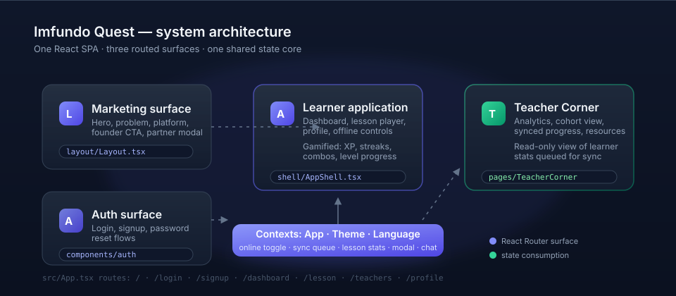
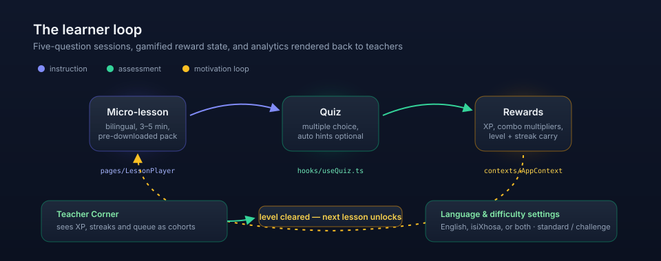
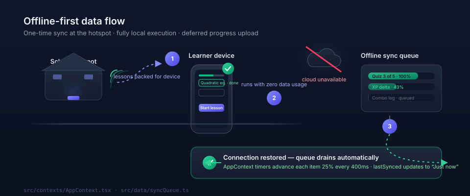
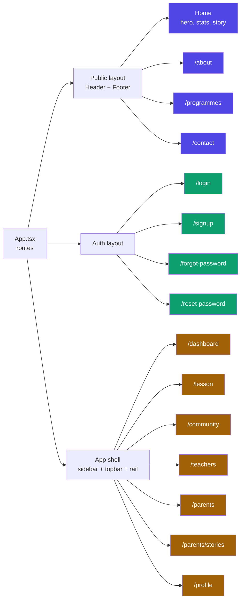
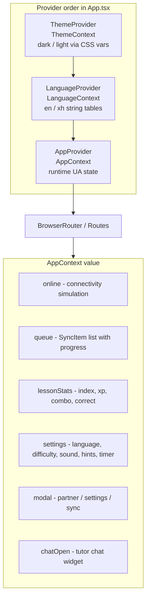

# Imfundo Quest

An offline-first learning platform prototype for rural high school learners in Idutywa, Eastern Cape (Grades 10-12). The core premise: on-device AI tutoring and gamified micro-lessons that require no data, no Wi-Fi, and no waiting -- *learning that works, even when the internet doesn't*.

This repository is a fully working front-end prototype. Everything runs client-side against realistic demo data, so every screen is explorable end-to-end without a backend.

---

## Table of contents

- [Why this exists](#why-this-exists)
- [Product surfaces](#product-surfaces)
- [The learner loop](#the-learner-loop)
- [Offline-first execution](#offline-first-execution)
- [Navigation map](#navigation-map)
- [State architecture](#state-architecture)
- [Design system](#design-system)
- [Project structure](#project-structure)
- [Getting started](#getting-started)
- [Scripts](#scripts)
- [Deployment](#deployment)
- [Scope and limitations](#scope-and-limitations)
- [Roadmap](#roadmap)

---

## Why this exists

The device barrier in rural South Africa has effectively been solved: mobile phone ownership in target communities is close to universal. The remaining gap is *offline execution* -- learners cannot stream video during expensive data sessions, school connectivity is intermittent, and conventional e-learning products silently assume bandwidth. Imfundo Quest inverts that assumption: content is packed once onto a device at a school hotspot, and every interaction afterwards is local.

| Dimension | Detail |
| --- | --- |
| Audience | Grades 10-12, Idutywa, Eastern Cape |
| Subjects | Mathematics, Physical Sciences, Computer Literacy, English |
| Session shape | 3-5 minute micro-lessons, 5-question quizzes |
| Languages | English and isiXhosa substitution paths |

## Product surfaces

One React SPA exposing public marketing, local auth and a role-aware app shell for learners, staff and parents. Marketing and auth surfaces live under a public layout; the learner, staff and parent applications share an app shell with persistent sidebar, topbar and activity rail.



| Surface | Route | Entry file | Highlights |
| --- | --- | --- | --- |
| Marketing | `/` | [src/pages/Home.tsx](src/pages/Home.tsx) | Hero, key statistics, problem framing, why-us cards, how-it-works, founder story, partner CTA |
| Marketing | `/about` | [src/pages/About.tsx](src/pages/About.tsx) | Mission, beliefs, stakeholder tiers, founder story |
| Marketing | `/programmes` | [src/pages/Programmes.tsx](src/pages/Programmes.tsx) | How it works, learning features, subject packs |
| Marketing | `/contact` | [src/pages/Contact.tsx](src/pages/Contact.tsx) | Contact details and enquiry form |
| Application | `/dashboard` | [src/pages/Dashboard.tsx](src/pages/Dashboard.tsx) | XP bar, streak, offline-ready counter, lesson list, sync-queue panel |
| Application | `/lesson` | [src/pages/LessonPlayer.tsx](src/pages/LessonPlayer.tsx) | Question flow, settings modal, completion summary with XP and accuracy |
| Application | `/community` | [src/pages/Community.tsx](src/pages/Community.tsx) | Learner study room: interest-matched rooms, learner-created rooms, join/leave, unread counts, peer chat, message support and replies, meet-up RSVPs, shared past papers |
| Application | `/teachers` | [src/pages/TeacherCorner.tsx](src/pages/TeacherCorner.tsx) | Cohort analytics, synced progress, resources tab |
| Application | `/parents` | [src/pages/ParentCorner.tsx](src/pages/ParentCorner.tsx) | Linked learner progress, weekly rhythm, recent updates, home-support tips, teacher note |
| Application | `/parents/stories` | [src/pages/ParentStories.tsx](src/pages/ParentStories.tsx) | Searchable learning-method story library, with article pages at `/parents/stories/:storyId` |
| Application | `/profile` | [src/pages/Profile.tsx](src/pages/Profile.tsx) | Learner identity, storage budget, badges, preferences, activity log |
| Auth | `/login`, `/signup`, `/forgot-password`, `/reset-password` | [src/pages/auth](src/pages/auth) | Learner/staff/parent roles, child linking, password strength meter, validation and reset flow mock |

## The learner loop

Gamification is wired into real component state, not decorative copy. Progress, XP, combo, and accuracy values flow from the quiz engine into the completion summary, the dashboard, and the teacher analytics view.



1. A micro-lesson opens from the list of pre-downloaded packs.
2. The quiz engine ([src/hooks/useQuiz.ts](src/hooks/useQuiz.ts)) advances questions, scoring XP and combo multipliers.
3. Reward state accumulates in [src/contexts/AppContext.tsx](src/contexts/AppContext.tsx) and is surfaced as level progress ([src/data/lessons.ts](src/data/lessons.ts)).
4. Clearing a session feeds the next lesson in the path.

## Offline-first execution

The signature mechanic. An online/offline switch on the dashboard (and in lessons) simulates connectivity. While offline, progress accumulates into a visible sync queue. When connectivity is restored, the queue drains automatically -- each item advances 25 percent every 400 ms -- and the "last synced" label updates.



Key mechanics, in source terms:

- Queue definition: [src/data/syncQueue.ts](src/data/syncQueue.ts)
- Drain timers and "just synced" transitions: [src/contexts/AppContext.tsx](src/contexts/AppContext.tsx) (two `useEffect` intervals)
- Panel rendering in both plain and card variants: [src/components/dashboard/SyncQueuePanel.tsx](src/components/dashboard/SyncQueuePanel.tsx)
- Detail drawer with per-item progress: `src/components/modals/SyncDetailsModal.tsx`

## Navigation map

The diagram below is navigable: click any node to open the corresponding source file.



## State architecture

Three independent context providers wrap the router. No external state library is used; state is intentionally scoped so each concern can be read with a single hook.



- Theme: [src/contexts/ThemeContext.tsx](src/contexts/ThemeContext.tsx) flips the full slate scale plus semantic tokens defined in [src/index.css](src/index.css), so dark and light mode recolor 100 percent of the UI without per-component conditionals.
- Language: [src/contexts/LanguageContext.tsx](src/contexts/LanguageContext.tsx) with tables in [src/data/i18n.ts](src/data/i18n.ts) covering navigation, landing copy, dashboard, lessons, auth, community and parent surfaces.
- Accounts: [src/utils/auth.ts](src/utils/auth.ts) stores learner, staff and parent accounts in `localStorage`. Parent accounts may hold a `childEmail`, which Parent Corner uses to read that learner’s on-device progress.
- Study room: [src/utils/community.ts](src/utils/community.ts) is a `useSyncExternalStore` store over `localStorage` key `imfundo-community-v1`, so learner accounts on the same browser share one chat, room list and paper library.
- Interests: learners pick up to six interests at signup or in Profile. The catalog lives in [src/data/interests.ts](src/data/interests.ts), accounts store the ids, and every room is tagged with the same ids. `roomMatchScore()` sorts rooms by shared interests; `markRoomRead()` and `unreadRoomCount()` power unread badges. Rooms are either curated (seeded) or learner-created, and learner-created rooms can be reported for teacher review or deleted by their creator.
- Settings flow from the lesson settings modal into both the lesson player and the dashboard rail.

## Design system

Tokens are CSS custom properties re-mapped per theme; Tailwind reads them through `rgb(var(--token) / alpha)`. Both themes render real contrast rather than tinted duplicates.

New visitors start in light mode. The topbar theme toggle switches to dark and persists the choice in `localStorage`; an inline script in `index.html` applies the saved theme before first paint to avoid a flash. Public marketing and auth surfaces are intentionally always light via a scoped `.theme-light` wrapper. The learner and staff app keeps both themes, and its shell, dashboard, lesson player, profile, and teacher pages share the same ink borders, offset shadows, and accent chips as the marketing site.

| Token | Dark value | Light handling |
| --- | --- | --- |
| `slate-50..950` | inverse-scaled ramp | mirrored so borders and text invert cleanly |
| `canvas` | `15 23 42` | `248 250 252` |
| `ink` / `ink-soft` | navy text and borders | same deep navy in both themes |
| `sun` / `sun-light` | warm yellow accents | same vivid accent, soft tint for fills |
| `coral` / `teal` / `sky` | accent trio | same hues, `teal-light` and `sky-light` for soft fills |
| `primary` | `#6366F1` | same hue family, darker softs |
| `success` / `warn` / `danger` | emerald, amber, rose | darkened for contrast on light canvas |

Component contracts worth knowing before contributing:

- `glass-card`, `btn-primary`, `btn-secondary`, `field` are defined once in [src/index.css](src/index.css) (Tailwind `@layer components`) and used app-wide.
- Framer Motion is throttled through a single `MotionConfig reducedMotion="user"` in [src/App.tsx](src/App.tsx).
- Route transitions trigger a crawl-and-settle skeleton via [src/hooks/useRouteLoading.ts](src/hooks/useRouteLoading.ts).
- Illustrated diagrams are hand-coded, theme-aware inline SVGs under [src/components/illustrations](src/components/illustrations); standalone documentation art lives under [docs/assets](docs/assets).

## Project structure

```
src/
  App.tsx                     # provider stack + route table
  index.tsx                   # mount
  index.css                   # tokens, themes, component contracts
  components/
    auth/                     # auth layout, inputs, strength meter
    community/                # message bubbles, past-paper cards, upload and preview modals
    dashboard/                # lesson list, sync queue panel
    illustrations/            # OfflineSync, ConnectivityGrid, SecureDevice, LearningPath
    landing/                  # Hero, InsightBand, ProblemOpportunity, PlatformSection, FounderCta
    layout/                   # Header, Footer, switches, chat widget, overlays, logo
    lesson/                   # completion summary
    mockups/                  # device mockups for landing
    modals/                   # partner, settings, sync details
    parent/                   # learning-story cards
    shell/                    # app shell, sidebar, topbar, rails
    teacher/                  # analytics and resources tabs
    ui/                       # buttons primitives: phone frame, modal, toggle, skeleton, grid
  contexts/                   # Theme, Language, App
  data/                       # lessons, quiz, i18n, nav, profile, teacher, community, parent stories
  hooks/                      # useQuiz, useRouteLoading, useSimulatedLoad
  pages/                      # Home, About, Programmes, Contact, Dashboard, LessonPlayer, Community,
                              # TeacherCorner, ParentCorner, ParentStories, ParentStory, Profile, auth/*
  types/                      # app, community and learning type modules
  utils/                      # auth, community store, parent snapshot, file attachments, tutor logic
```

## Getting started

Prerequisites: Node.js 20.19 or newer.

```bash
npm install
npm run dev       # local dev server
```

Then open the printed localhost URL. Application routes require a local account, so create one from `/signup` or use a demo account below.

### Demo accounts

Open `/login` to prepare three local demo accounts automatically. You can either select one of the **Demo testing access** buttons or type the credentials manually. All demo accounts use the password `Imfundo#2026`.

| Role | Email | Opens |
| --- | --- | --- |
| Learner | `learner@demo.imfundoquest.co.za` | `/dashboard` with seeded XP, streak and recent activity |
| Parent | `parent@demo.imfundoquest.co.za` | `/parents`, already linked to the demo learner |
| Teacher | `teacher@demo.imfundoquest.co.za` | `/teachers` staff workspace |

The learner demo includes a completed quiz, a four-day streak and activity history so Parent Corner and the profile views have something real to display. Demo accounts and their data live in this browser only. To start over, clear the site's local storage.

To explore the parent and study-room features with your own accounts:

1. Create a learner account, open a lesson and answer a question so there is progress to show.
2. Sign out, then create a parent account using that learner’s email in **Child’s learner email**. Parent Corner will show live progress from the same browser. A parent account without a child email shows sample data instead.
3. Sign back in as the learner to open `/community`, chat with the sample peers, RSVP to a meet-up and share a past paper. Parent Corner is available at `/parents` and the story library at `/parents/stories`.

## Scripts

| Command | Purpose |
| --- | --- |
| `npm run dev` | Vite development server |
| `npm run build` | Production bundle into `dist/` |
| `npm run preview` | Serve the production bundle locally |
| `npm run lint` | ESLint across ts/tsx |
| `npm run typecheck` | TypeScript check without emitting files |

## Deployment

The app is a single-page application using client-side routing. Deep links must fall back to `index.html`; that behavior is declared in [vercel.json](vercel.json):

```json
{
  "rewrites": [{ "source": "/(.*)", "destination": "/index.html" }]
}
```

On Vercel the zero-config flow works: import the repository, framework preset Vite, build command `npm run build`, output directory `dist`. Any other static host needs an equivalent SPA rewrite (Netlify redirect rule, Nginx `try_files`, or similar).

## Scope and limitations

Being explicit about the prototype boundary:

- There is no backend, database or server-side auth. Accounts and sessions live in `localStorage`, with a client-side SHA-256 password hash. This is suitable for a prototype, not production security.
- Parent Corner can only read a linked learner’s progress when both accounts exist in the same browser. There is no cross-device or cloud sync.
- Study-room peers, online counts, member baselines and meet-up hosts are sample data. Learner messages, RSVPs, rooms, memberships, read state and papers are stored locally in `localStorage` and are shared only by accounts in that browser.
- Interest matching runs entirely on-device against the learner’s chosen interests. Learner-created rooms are visible only in the same browser, and “report” adds a local review flag rather than sending anything to a teacher.
- Uploaded chat files and past papers are stored as data URLs capped at 1.2 MB. They are not uploaded to a server.
- The AI tutor chat is a scripted local responder ([src/utils/tutor.ts](src/utils/tutor.ts)); it does not run a model.
- Learner progress persists in `localStorage`; the offline sync queue and its timers are a simulation.
- Analytics in Teacher Corner derive from the same in-memory demo tables.
- Password strength is a heuristic meter, not a policy enforcement point.

## Roadmap

Candidate next steps, ordered by user value:

1. Introduce a service worker for true asset-level offline caching.
2. Wire real accounts, parent–learner linking and cross-device progress sync behind the existing auth and parent-snapshot contracts.
3. Add a teacher review queue for reported rooms and messages (room reporting currently sets a local flag).
4. Replace the in-memory sync queue with IndexedDB or a queued request layer.
5. Localize remaining untranslated strings and expand the isiXhosa tables.
